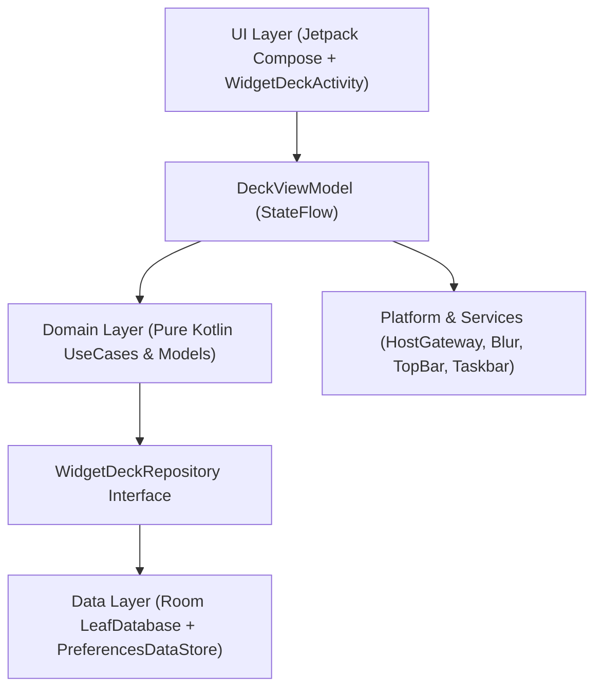

# WidgetLeaf System Architecture (`_agents/ARCHITECTURE.md`)

> [!NOTE]
> **Keep This Document Updated:** Whenever you modify layer boundaries, grid math, window flags, top-bar overlay placement, or widget gesture routing, update this document in the same commit.

---

## 1. Clean 4-Layer Architecture

WidgetLeaf follows a strict unidirectional 4-layer architecture wired through `AppContainer` (`di/AppContainer.kt`):

### 1.1 Domain Layer (`domain/`)
Pure Kotlin models and deterministic use cases with zero Android UI dependencies:
- **`DesktopGridProfile` & `DesktopGridProfileResolver`:** Computes responsive grid dimensions by stretching columns and cell width across the full available canvas width dynamically measured via Compose `BoxWithConstraints` and `WindowMetrics`. Symmetrically balances horizontal margins (`marginDp = (availableWidth - totalGridWidth) / 2`, ensuring `leftMargin == rightMargin`) across all screen sizes (e.g. 1024×640, 1280×800, 1440×900, 1920×1080, and portrait), eliminating right-side empty dead zones. Reserves `84dp` bottom clearance above the pagination HUD. When columns/rows shrink on orientation or window resize, `DeckViewModel.updateGridProfile` clamps spans and reflows out-of-bounds widgets without overlaps, keeping existing widgets stationary when columns expand.
- **`CascadeDisplacementResolver`:** Pure, deterministic algorithm for desktop-style cascade widget displacement. When a widget is dropped, moved, or resized onto space occupied by others:
  - The dragged/placed widget settles at its target cell with its original span preserved (or resized bounds).
  - Any intersecting widgets keep their spans and search for free spots in COLUMN-MAJOR order (downward first, then next column right, then next page top-left, dynamically creating pages as needed).
  - Anything they land on gets displaced in the same manner. Vacated cells become available. No compaction is performed.
- **`GridCollisionResolver`:** Provides `findFirstAvailableSpot` row-by-row scan across active page cells for auto-placement from the catalog.
- **`EdgePageDragTransferUseCase`:** Handles dragging a widget across the left (`EdgeDirection.LEFT`) or right (`EdgeDirection.RIGHT`) edge of a page. Uses `CascadeDisplacementResolver` when landing on occupied cells of an adjacent page (cascading displaced widgets across pages) and prunes empty source pages.
- **`CalculateResponsiveSizesUseCase` & `WidgetSpanCalculator`:** Computes multi-orientation `OPTION_APPWIDGET_SIZES` (`ArrayList<SizeF>`) and `min/max` dp bounds for `AppWidgetHostView.updateAppWidgetSize(...)`. Notice that user manual resize in `DeckViewModel.resizeWidget` and `WidgetEditResizeFrame` is bounded only by the grid dimensions (`1 .. gridProfile.columns/rows`), never artificially capped by provider `maxResizeWidth`/`maxResizeHeight`.

### 1.2 Data Layer (`data/`)
- **`LeafDatabase` (Room):**
  - `deck_pages` (`DeckPageEntity`): Stores `pageIndex` (`0 .. N-1`) and optional `customLabel`.
  - `widget_placements` (`WidgetPlacementEntity`): Foreign-keyed to `deck_pages` (`ON DELETE CASCADE`) with indices on `pageIndex` and `(pageIndex, cellX, cellY)`.
- **`DefaultWidgetDeckRepository`:** Executes multi-widget moves, edge transfers, and empty-page pruning inside `database.withTransaction { ... }`. Always guarantees Page `0` exists and re-packs remaining page indices contiguously (`0 .. K-1`) when an empty trailing/intermediate page is pruned.
- **`PreferencesDataStore`:** Persists `OverlaySettings` (`openOnPageOne`, `launchOnStartup`, `topBarPosition`, `pinTopBarRightQsTile`, `hotkeyKeyCode`, `hotkeyModifiers`, `blurRadiusDp`, `scrimAlpha`, `useDynamicColor`, `lastActivePageIndex`, `useCenteredBentoCanvas`).

### 1.3 Platform & Services Layer (`platform/` & `services/`)
- **`WidgetLeafTopBarService` (`AccessibilityService`):**
  - Renders a compact `28×24dp` clickable leaf pill directly inside the Android Desktop top status bar (`Gravity.TOP or Gravity.START`, `y = 0`) using `WindowManager.LayoutParams.TYPE_ACCESSIBILITY_OVERLAY` with `LAYOUT_IN_DISPLAY_CUTOUT_MODE_ALWAYS`.
  - **BentoBar Coexistence (`StatusBarSpaceScanner`):** Scans the `TYPE_WINDOWS_CHANGED` / root accessibility hierarchy for existing status-bar clock/notification clusters and third-party overlays (`BentoBar`) so the WidgetLeaf icon automatically offsets its horizontal `x` coordinate (`Left` or `Right` of the center gap) without colliding.
  - **Global Hotkey Interception (`onKeyEvent`):** Intercepts the user-configured global hotkey (default `Alt + W`) system-wide and toggles `WidgetDeckActivity`.
- **`StatusBarTriggerManager`:** Posts a low-priority ongoing silent status-bar notification trigger for immediate access to WidgetLeaf and settings.
- **`TaskbarPlacementManager`:** Ensures `ActivityManager.AppTask.setExcludeFromRecents(true)` is always set so WidgetLeaf never duplicates in the right-side running taskbar (since WidgetLeaf's primary desktop home is the top bar), and updates dynamic launcher shortcuts for desktop right-click access to Add Widget and Overlay Settings.
- **`BootCompletedReceiver`:** Listens for `ACTION_BOOT_COMPLETED` / `ACTION_MY_PACKAGE_REPLACED` and restores background triggers (`StatusBarTriggerManager`, `WidgetDeckTileService`) in the background **without** popping open the overlay UI.

### 1.4 UI Layer (`ui/`)
- **`WidgetDeckActivity`:** Single-instance translucent overlay activity. Hosts `WidgetDeckHost` (`AppWidgetHost`), handles the system `ACTION_APPWIDGET_BIND` and configuration result flows, applies window blur via `AndroidWindowBlurController`, and handles keyboard navigation (`Left`/`Right`/`PageUp`/`PageDown`, `1..9`/`0`, `Delete`, and `Escape` / any non-UI key to dismiss when no modal/editor is active).
- **`DeckViewModel` & `DeckUiState`:** Manages overlay state and drag sessions.
  - `startWidgetDrag(appWidgetId)`: Captures snapshot of all widgets, pages, start page, and start cell at drag start.
  - `onEdgeDwellTriggered(direction)`: Handles 500 ms continuous edge dwell, advancing pages (LEFT stops at 0; RIGHT synthesizes speculative pages), updating `activePageIndex` and `previewPageCount`, and running cascade displacement on the new active page.
  - `onWidgetHoverCellChanged(appWidgetId, cellX, cellY)`: 250ms debounced preview computation running `CascadeDisplacementResolver` on the active page against snapshot; immediately reverts if hovering back on start cell on start page.
  - `commitWidgetDrag(appWidgetId, cellX, cellY)`: Cancels debounce, immediately executes cascade resolution on active page from snapshot, prunes unused speculative pages, and atomically persists via `repository.replaceDeckState`.
  - `cancelWidgetDrag()`: Clears preview, restores start page and snapshot pages, and discards speculative pages.
  - Separates `moveWidget` (preserves all spans) from `resizeWidget` (updates bounds).
  - Exposes `effectiveWidgets` and `effectivePages` for UI rendering and pagination HUD.
  - Synchronizes widget sizes via `syncWidgetSizes` on first `widgetsFlow` emission, `onOverlayShown`, manual resize, and profile updates, deduping emissions against `lastSyncedWidgetSpans` to eliminate redundant gateway traffic.
- **`WidgetDeckHost`, `DeckAppWidgetHostView` & `DeckWidgetHostContainer`:** Custom `AppWidgetHost`, `AppWidgetHostView` subclass, and Compose wrapper:
  - **Single-Parent Enforcement & View Cache Safety (INV-16):** `WidgetDeckHost.createHostView` caches `DeckAppWidgetHostView` by `appWidgetId` and detaches from any parent ViewGroup (`(view.parent as? ViewGroup)?.removeView(view)`) before returning. `DeckWidgetHostContainer` wraps `DeckAppWidgetHostView` in a lightweight `FrameLayout` container whose `onRelease`/`onReset` only detaches children strictly owned by *that* container (`detachHostViewIfOwned`), preventing outgoing containers from stripping the cached host view after it was adopted by an incoming container.
  - **Zero Padding Enforcement (INV-13):** Forces padding to 0 in `init`, `setPadding`, `setPaddingRelative`, and `setAppWidget` so API 31+ `RemoteViews.findBestFitLayout` available dimensions match reported sizes (`DesktopGridProfile.widthDpForSpan/heightDpForSpan`) exactly without fallback truncation.
  - `INTERACTIVE`: Standard widget click/scroll dispatch; intercepts secondary/Ctrl clicks and long-presses to enter `EDIT_MODE`.
  - `EDIT_MODE`: `dispatchTouchEvent` returns `false` so Compose owns 100% of pointer drag, resize, and button click events above the widget.
- **`WidgetDeckOverlayScreen`, `WidgetEditDragLayer` & `WidgetGridPage`:**
  - **Overlay Drag Layer (INV-15):** Hoists the active edit-mode move surface, resize frame, and live floating visual into `WidgetEditDragLayer` positioned strictly above `AnimatedContent`. Intra-drag page flips animate underneath without disposing the pointer coroutine or detaching the host view.
  - **In-Drag Edge Dwell (INV-17):** Holding at the edge for 500 ms triggers mid-drag page flips, repeating every 500 ms while held; leaving the edge zone cancels the timer. Dropping commits on the newly active page with cascade; escape/cancel reverts to start page and snapshot. Old drop-at-edge bump behavior is removed.
  - **`WidgetGridPage`:** Renders frameless non-editing widgets on the Bento grid with `key(widget.appWidgetId)` and spring physics (`PAGE_FLIP_SPRING_DAMPING`, `PAGE_FLIP_SPRING_STIFFNESS`). Skips rendering any widget currently in edit mode or dragging (`editingWidgetId` / `draggingWidgetId`). Renders a subtle emerald drop-target ghost outline at `hoveredCell` on the active page.
  - **`WidgetEditResizeFrame` (`GlassSurfaceBox.kt`):** Renders inside `WidgetEditDragLayer`, displaying the emerald edit frame, centered `Reconfigure | Remove` action pill, and 4 centered perimeter resize handles (~64×20dp / 20×64dp hit area) with live resize preview and native desktop resize cursors (`TYPE_VERTICAL_DOUBLE_ARROW`, `TYPE_HORIZONTAL_DOUBLE_ARROW`, `TYPE_ALL_SCROLL`).
