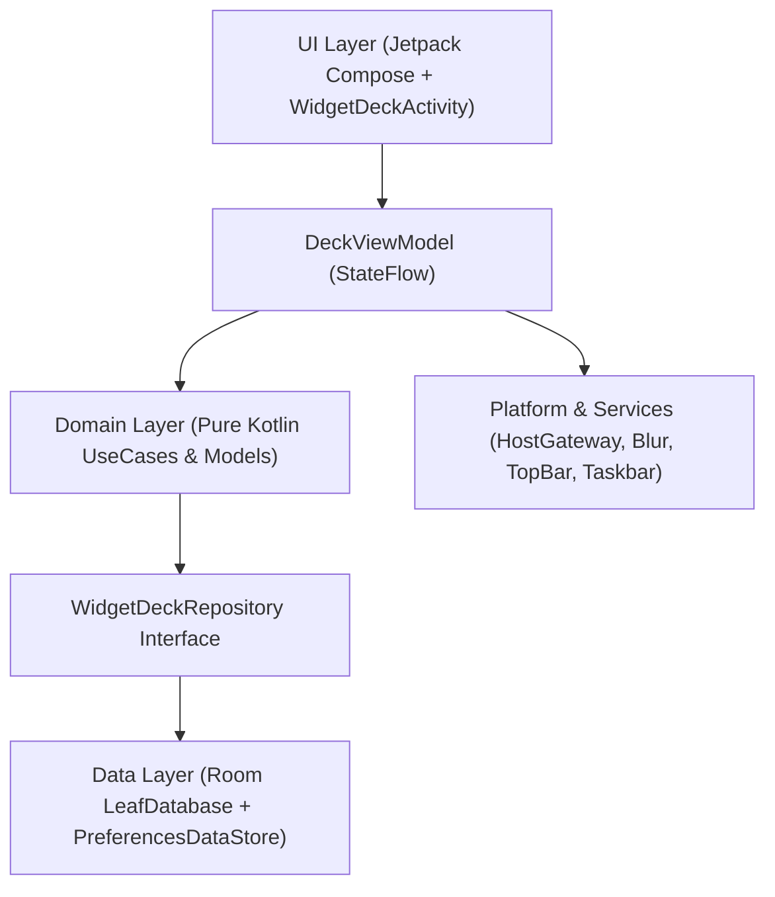

# WidgetLeaf System Architecture (`_agents/ARCHITECTURE.md`)

> [!NOTE]
> **Keep This Document Updated:** Whenever you modify layer boundaries, grid math, window flags, top-bar overlay placement, or widget gesture routing, update this document in the same commit.

---

## 1. Clean 4-Layer Architecture

WidgetLeaf follows a strict unidirectional 4-layer architecture wired through `AppContainer` (`di/AppContainer.kt`):

### 1.1 Domain Layer (`domain/`)
Pure Kotlin models and deterministic use cases with zero Android UI dependencies:
- **`DesktopGridProfile` & `DesktopGridProfileResolver`:** Computes responsive grid dimensions dynamically from Compose `BoxWithConstraints` (`OverlayViewportMetrics`) paired with `WindowInsets.systemBars.union(WindowInsets.displayCutout)` or `WindowMetrics` insets. Respects safe horizontal/top/bottom insets (`topMarginDp >= topInsetDp + gap`, bottom reserved = `84dp + bottomInsetDp`), enforces `MAX_CANVAS_WIDTH_DP = 1440f` centered with symmetric safe margins when `useCenteredBentoCanvas == true` (filling the full safe width when disabled), and scales min cell/gutter/margins down cleanly on small windows (`< 440×456dp`) so nothing clips or overlaps the HUD. One shared layout is maintained globally across displays: when columns/rows shrink, `DeckViewModel.updateGridProfile` preserves a persisted `lastGoodGridSize` (`lastGoodProfile`) baseline across restarts and asymmetric orientation transitions, reflows out-of-bounds widgets for display only, never mutates raw Room placements in `onOverlayShown`, and evaluates drag/resize previews via the same `effectiveProfile` / raw commit pipeline as `commitWidgetDrag` / `commitWidgetResize`.
- **`CascadeDisplacementResolver`:** Pure, deterministic algorithm for desktop-style cascade widget displacement. When a widget is dropped, moved, or resized onto space occupied by others:
  - The dragged/placed widget settles at its target cell with its original span preserved (or resized bounds).
  - Any intersecting widgets keep their spans and search for free spots in COLUMN-MAJOR order (downward first, then next column right, then next page top-left, dynamically creating pages as needed).
  - Anything they land on gets displaced in the same manner. Vacated cells become available. No compaction is performed.
- **`GridCollisionResolver`:** Provides `findFirstAvailableSpot` column-major scan (downward first within a column, then next column right) across page cells for new widget placement, matching the column-major ordering of `CascadeDisplacementResolver`.
- **New Widget Placement (Non-Displacement Rule, INV-19):** Adding a new widget via catalog auto-place (`DeckViewModel.addWidgetAutoPlace`) or catalog drag-drop (`DeckViewModel.dropCatalogWidgetAtCell`) never displaces existing widgets. If the target spot/page cannot accommodate the widget, it searches subsequent pages in order, appending a new page if necessary, and navigates to the placement page. Moving and resizing existing placed widgets retains cascade displacement.
- **`EdgePageDragTransferUseCase`:** Handles dragging a widget across the left (`EdgeDirection.LEFT`) or right (`EdgeDirection.RIGHT`) edge of a page. Uses `CascadeDisplacementResolver` when landing on occupied cells of an adjacent page (cascading displaced widgets across pages) and prunes empty source pages.
- **`CalculateResponsiveSizesUseCase` & `WidgetSpanCalculator`:** Computes multi-orientation `OPTION_APPWIDGET_SIZES` (`ArrayList<SizeF>`) and `min/max` dp bounds for `AppWidgetHostView.updateAppWidgetSize(...)`. `WidgetSpanCalculator` honors `minWidthDp` / `minHeightDp` alongside `targetCellWidth` / `targetCellHeight` when computing initial catalog spans. Manual user resizing in `DeckViewModel.resizeWidget` and `WidgetEditResizeFrame` is bounded by provider `minSpan`, explicit `maxSpan` (when non-zero), and the grid dimensions.

### 1.2 Data Layer (`data/`)
- **`LeafDatabase` (Room):**
  - `deck_pages` (`DeckPageEntity`): Stores `pageIndex` (`0 .. N-1`) and optional `customLabel`.
  - `widget_placements` (`WidgetPlacementEntity`): Foreign-keyed to `deck_pages` (`ON DELETE CASCADE`) with indices on `pageIndex` and `(pageIndex, cellX, cellY)`.
- **`DefaultWidgetDeckRepository`:** Executes multi-widget moves, edge transfers, raw metadata refreshes (`updateWidgetCatalogMetadata` — touches metadata columns only, never coordinates/spans), and empty-page pruning inside `database.withTransaction { ... }`. Always guarantees Page `0` exists and re-packs remaining page indices contiguously (`0 .. K-1`) when an empty trailing/intermediate page is pruned.
- **`PreferencesDataStore`:** Persists `OverlaySettings` (`openOnPageOne`, `launchOnStartup`, `topBarPosition`, `pinTopBarRightQsTile`, `hotkeyKeyCode`, `hotkeyModifiers`, `blurRadiusDp`, `scrimAlpha`, `useDynamicColor`, `lastActivePageIndex`, `useCenteredBentoCanvas` defaulting to `true`) plus `lastGoodGridSizeFlow` (`KEY_LAST_GOOD_COLUMNS`, `KEY_LAST_GOOD_ROWS`) so shrunk cold starts retain the baseline grid dimensions.

### 1.3 Platform & Services Layer (`platform/` & `services/`)
- **`WidgetLeafTopBarService` (`AccessibilityService`):**
  - Uses `DisplayManager.DisplayListener` and per-display `createDisplayContext(display).createWindowContext(TYPE_ACCESSIBILITY_OVERLAY, null)` (`DisplayTopBarEntry`) to attach an independent `28×24dp` leaf pill inside the top status bar on every non-private display that actually has a top status bar (`LAYOUT_IN_DISPLAY_CUTOUT_MODE_ALWAYS`). On bottom-taskbar-only shells or displays lacking both a top `TYPE_SYSTEM` status bar window and positive visible `statusBars().top` inset, hides the leaf (`View.INVISIBLE`, no fallback floating pill).
  - **Per-Display BentoBar & Cutout Coexistence (`StatusBarSpaceScanner`):** Filters `windowsOnAllDisplays` by `displayId`, uses dp-scaled height/spacer thresholds, subtracts `DisplayCutout` rects (`subtractCutouts`), accepts non-zero `barBounds.top` while rejecting bottom taskbars, and sets `WindowPlacement.hasRoom = false` if no horizontal segment fits alongside cutouts and `BentoBar`.
  - **Active-Display Hotkey & Trigger Routing (`ActiveDisplayLaunchHelper`, `ToggleDeckShortcutActivity`, `WidgetDeckTileService`, `StatusBarTriggerManager`):** Resolves the user's active display live via `windowsOnAllDisplays` / `findFocus(FOCUS_INPUT)` / visual `Context.getDisplay` (`getActiveDisplayId`), routes tile/notification/shortcut/top-bar/hotkey launches with `ActivityOptions.setLaunchDisplayId`, toggles off if already open on that display, or moves displays smoothly (`toggleOrLaunchOverlay`).
- **`OverlayDiagnosticsLog`:** Thread-safe `50`-event in-memory ring buffer capturing timestamped (`+deltaMs`) `onCreate`, `onStart`, `onResume`, `onPause`, `onStop`, `onWindowFocusChanged`, `onTopResumedActivityChanged`, `onUserLeaveHint`, `widget_interaction`, deferred dismissal scheduling/cancellation, temporary hide/restore, and `finish` reasons.
- **`TaskbarPlacementManager`:** Ensures `ActivityManager.AppTask.setExcludeFromRecents(true)` is always set so WidgetLeaf never duplicates in the right-side running taskbar, and updates dynamic launcher shortcuts for desktop right-click access to Add Widget and Overlay Settings.
- **`BootCompletedReceiver`:** Listens for `ACTION_BOOT_COMPLETED` / `ACTION_LOCKED_BOOT_COMPLETED` / `ACTION_MY_PACKAGE_REPLACED` and restores background triggers (`StatusBarTriggerManager`, `WidgetDeckTileService.requestListeningState` when QS tile is enabled) in the background **without** popping open the overlay UI. Enabled/disabled immediately via `OverlaySettingsSideEffectController` (`DONT_KILL_APP`) based on `launchOnStartup`.
- **`OverlaySettingsSideEffectController`:** Applies immediate system side effects whenever `isSettingsLoaded` is true and `OverlaySettings` loads or updates: synchronizes `BootCompletedReceiver` and `WidgetDeckTileService` component enabled states (`PackageManager.setComponentEnabledSetting` with `DONT_KILL_APP`), calls `TileService.requestListeningState` when the QS tile is enabled, and invokes `WidgetDeckTileService.requestPinQsTile` strictly on explicit user `false -> true` transitions.

### 1.4 UI Layer (`ui/`)
- **`WidgetDeckActivity`:** Single-instance translucent overlay activity (`taskAffinity="io.devnullapps.widgetleaf.overlay"`). Hosts `WidgetDeckHost` (`AppWidgetHost`), refreshes trackpad swipe thresholds in `onCreate` and `onConfigurationChanged`, releases Activity-owned host views in `onDestroy()`, handles `ACTION_APPWIDGET_BIND` and configuration results, applies window blur via `AndroidWindowBlurController`, and handles keyboard navigation (`Left`/`Right`/`PageUp`/`PageDown`, `1..9`/`0`, `Delete`, and `Escape` / non-UI dismiss keys).
  - **Widget Configuration Flow (INV-20):** 3rd party widget configuration activities are delegated to `WidgetConfigureTrampolineActivity` (`taskAffinity="io.devnullapps.widgetleaf.configure"`), finishing `WidgetDeckActivity` cleanly prior to launch and relaunching fullscreen on the same active display with `EXTRA_TARGET_PAGE_INDEX`.
  - **Ready Gating & Snap Transitions (INV-21):** `DeckUiState` provides `isReady` and `snapPageTransitions`. Layer 3 `AnimatedContent` and `PageIndicatorHud` are gated behind `uiState.isReady`.
  - **Deferred Widget Interaction & Foreground-Loss Dismissal (`INV-23`):** `DeckAppWidgetHostView` reports interactive `ACTION_UP` touches via `onWidgetClickedListener`/`onWidgetInteractionListener` without dismissing on click (`2500ms` window). When foreground shifts (`onUserLeaveHint`, `onPause` + focus/top-resumed loss, or `onStop`) while not guarded by internal flows or modals, `WidgetDeckActivity` never dismisses synchronously: it arms an `850ms` deferred dismissal (`DEFERRED_DISMISS_DELAY_MS`) paired with temporary window transparency (`decorView.alpha = 0f`, `FLAG_NOT_TOUCHABLE`, blur detached — after `120ms` grace on pause/focus-loss or immediately on `onStop`/`user_leave`) and cancels/restores immediately if `onResume`, `onWindowFocusChanged(true)`, `onTopResumedActivityChanged(true)`, or `onNewIntent` returns focus (keeping trampoline-based widgets such as Google Tasks open while cleanly hiding and closing launched apps such as Weather).
  - **Hotkey Toggle Coordination:** Tracks `activeInstance` and `isDeckVisible`. Dispatches hotkey dismissals via `onNewIntent` (only toggling off when already resumed & visible, otherwise cancelling deferred dismiss and reopening) and `dispatchKeyEvent` with `350ms` debounce and `300ms` creation grace.
  - **Trackpad Motion Dispatch:** Intercepts generic motion events in `dispatchGenericMotionEvent` using dynamically measured container height + bottom inset for the HUD band check, classifies trackpad swipes via `TrackpadGestureClassifier`, feeds deltas into `TrackpadSwipeAccumulator` with 1.2x dominant axis locking, and triggers `swipeNextPage`, `swipePreviousPage`, or `finishWithoutAnimation("swipe_dismiss_trackpad")`.
- **`DeckViewModel` & `DeckUiState`:** Manages overlay state, drag sessions, and resize sessions.
  - `startWidgetDrag(appWidgetId)` / `startWidgetResize(appWidgetId)`: Captures snapshot of all widgets, pages, start page, and start cell/bounds at gesture start.
  - `onEdgeDwellTriggered(direction)`: Handles 500 ms continuous edge dwell, advancing pages (LEFT stops at 0; RIGHT synthesizes speculative pages), updating `activePageIndex` and `previewPageCount`, and running cascade displacement on the new active page.
  - `onWidgetHoverCellChanged(appWidgetId, cellX, cellY)`: 250ms debounced preview computation running `CascadeDisplacementResolver` on the active page against snapshot; immediately reverts if hovering back on start cell on start page.
  - `onWidgetResizeBoundsChanged(appWidgetId, cellX, cellY, spanX, spanY)`: 250ms debounced preview computation running `CascadeDisplacementResolver` with the proposed resize bounds against snapshot; immediately reverts preview if proposed bounds return to non-overlapping or original bounds.
  - `commitWidgetDrag(appWidgetId, cellX, cellY)` / `commitWidgetResize(appWidgetId, cellX, cellY, spanX, spanY)`: Cancels debounce, immediately executes cascade resolution on active page from snapshot, prunes unused speculative pages, and atomically persists via `repository.replaceDeckState`.
  - `cancelWidgetDrag()` / `cancelWidgetResize()`: Clears preview, restores start page and snapshot pages, and discards speculative pages.
  - `swipePreviousPage()` & `swipeNextPage()`: Purely additive, boundary-enforced non-wrapping page navigation for swipe gestures (stops at Page 0 and last page; never synthesizes speculative pages).
  - Separates `moveWidget` (preserves all spans) from `resizeWidget` (updates bounds).
  - Exposes `effectiveWidgets` and `effectivePages` for UI rendering and pagination HUD.
  - Synchronizes widget sizes via `syncWidgetSizes` on first `widgetsFlow` emission, `onOverlayShown`, manual resize, and profile updates, deduping emissions against `lastSyncedWidgetSpans` to eliminate redundant gateway traffic.
- **`WidgetDeckHost`, `DeckAppWidgetHostView` & `DeckWidgetHostContainer`:** Custom `AppWidgetHost`, `AppWidgetHostView` subclass, and Compose wrapper:
  - **Environment-Keyed Cache, Single-Parent Enforcement & Leak Safety (INV-16):** `WidgetDeckHost.createHostView` caches `DeckAppWidgetHostView` keyed by `HostViewKey(appWidgetId, HostViewEnvironment(displayId, densityDpi, uiMode))` only while the underlying `Activity` owner (held via `WeakReference<Context>`) is alive, detaching any prior parent (`(view.parent as? ViewGroup)?.removeView(view)`) before returning it. `DeckWidgetHostContainer` wraps `AndroidView` in `key(placedWidget.appWidgetId, HostViewEnvironment.from(context, configuration))` and isolates `onRelease`/`onReset` via `detachHostViewIfOwned`. `WidgetDeckActivity.onDestroy()` invokes `releaseViewsForContext(this)` so destroyed Activities never retain views across density/display changes.
  - **Zero Padding Enforcement (INV-13):** Forces padding to 0 in `init`, `setPadding`, `setPaddingRelative`, and `setAppWidget` so API 31+ `RemoteViews.findBestFitLayout` available dimensions match reported sizes (`DesktopGridProfile.widthDpForSpan/heightDpForSpan`) exactly without fallback truncation.
  - **Scroll Query & Touch Routing (INV-18):** Exposes `canChildScrollHorizontally(direction)` and `canChildScrollVertically(direction)` across nested children (`HorizontalScrollView`, `ViewPager`, `ScrollView`, `ListView`, `RecyclerView`, `StackView`). In `dispatchGenericMotionEvent`, regular mouse wheels are swallowed without paging; trackpad events delegate to scrollable children or bubble to the parent activity. Exposes `cancelChildTouches()` to abort child presses upon gesture claim.
  - `INTERACTIVE`: Standard widget click/scroll dispatch; intercepts secondary/Ctrl clicks and long-presses to enter `EDIT_MODE`.
  - `EDIT_MODE`: `dispatchTouchEvent` returns `false` so Compose owns 100% of pointer drag, resize, and button click events above the widget.
- **`WidgetDeckOverlayScreen`, `WidgetEditDragLayer`, `WidgetGridPage` & Modals:**
  - **Viewport Metrics, Safe Insets & Tiled Noise Grain (`INV-24`):** `WidgetDeckOverlayScreen` measures real Compose bounds via `BoxWithConstraints`, unions `WindowInsets.systemBars` with `WindowInsets.displayCutout` into `OverlayViewportMetrics`, applies `navigationBars.union(displayCutout)` padding to `PageIndicatorHud`, adds `systemBars.union(displayCutout)` + `imePadding()` + adaptive `heightIn` to `WidgetPickerBottomSheet` and `OverlaySettingsDialog`, clamps `DesktopContextMenu` inside container bounds with `16dp` margins, and renders the background noise grain once into a `ShaderBrush` tile (`createNoiseGrainBrush`).
  - **Collapsible Diagnostics (`OverlaySettingsDialog`):** Renders an expandable **Diagnostics** drawer above the version footer displaying `OverlayDiagnosticsLog.formatReport()` with one-tap **Copy** (`ClipboardManager`) and **Clear** actions.
  - **Root Touch Swipe Gestures (`overlaySwipeGestures`, INV-18):** Intercepts 1-finger touch gestures at the overlay root in `PointerEventPass.Initial`. Employs 1.2x dominant-axis locking and queries widget scrollability via `canWidgetScroll`. If a widget cannot scroll in that direction, claims the touch stream, invokes `onCancelChildTouches`, and executes `swipeNextPage`, `swipePreviousPage`, or `onDismissOverlay` upon reaching distance or velocity thresholds. Disabled in edit mode.
  - **Overlay Drag Layer (INV-15):** Hoists the active edit-mode move surface, resize frame, and live floating visual into `WidgetEditDragLayer` positioned strictly above `AnimatedContent`. Intra-drag page flips animate underneath without disposing the pointer coroutine or detaching the host view.
  - **In-Drag Edge Dwell (INV-17):** Holding at the edge for 500 ms triggers mid-drag page flips, repeating every 500 ms while held; leaving the edge zone cancels the timer. Dropping commits on the newly active page with cascade; escape/cancel reverts to start page and snapshot. Old drop-at-edge bump behavior is removed.
  - **`WidgetGridPage`:** Renders frameless non-editing widgets on the Bento grid with `key(widget.appWidgetId)` and spring physics (`PAGE_FLIP_SPRING_DAMPING`, `PAGE_FLIP_SPRING_STIFFNESS`). Skips rendering any widget currently in edit mode or dragging (`editingWidgetId` / `draggingWidgetId`). Renders a subtle emerald drop-target ghost outline at `hoveredCell` on the active page.
  - **`WidgetEditResizeFrame` (`GlassSurfaceBox.kt`):** Renders inside `WidgetEditDragLayer`, displaying the emerald edit frame, centered `Reconfigure | Remove` action pill, 4 centered perimeter resize handles (~64×20dp / 20×64dp hit area), and 4 diagonal corner handles (~28dp square hit area with diagonal cursors `TYPE_TOP_LEFT_DIAGONAL_DOUBLE_ARROW` / `TYPE_TOP_RIGHT_DIAGONAL_DOUBLE_ARROW` rendered ONLY for `RESIZE_BOTH`), supporting live cascade preview and native desktop resize cursors.
