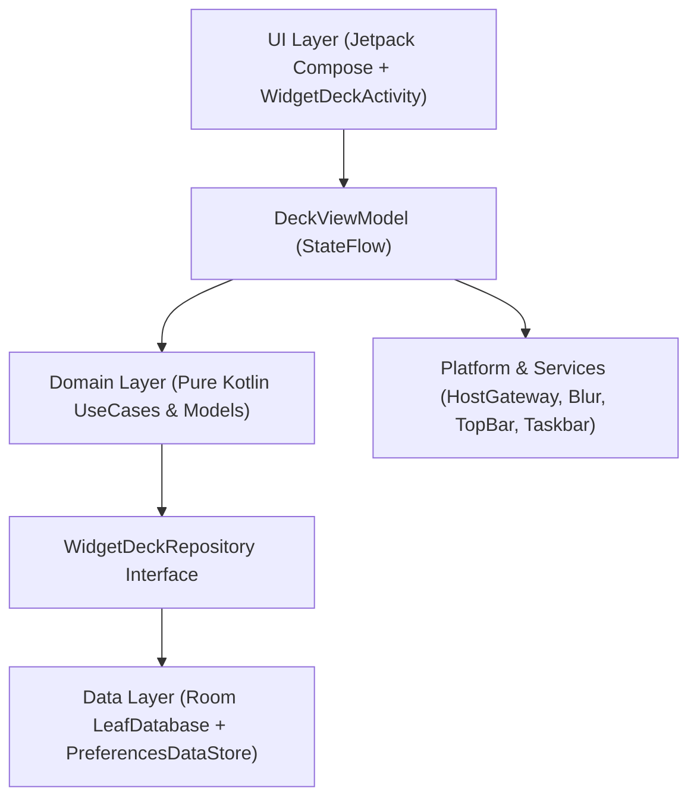

# WidgetLeaf System Architecture (`_agents/ARCHITECTURE.md`)

> [!NOTE]
> **Keep This Document Updated:** Whenever you modify layer boundaries, grid math, window flags, top-bar overlay placement, or widget gesture routing, update this document in the same commit.

---

## 1. Clean 4-Layer Architecture

WidgetLeaf follows a strict unidirectional 4-layer architecture wired through `AppContainer` (`di/AppContainer.kt`):

### 1.1 Domain Layer (`domain/`)
Pure Kotlin models and deterministic use cases with zero Android UI dependencies:
- **`DesktopGridProfile` & `DesktopGridProfileResolver`:** Computes responsive grid dimensions (`8×8` on expanded/ultra-wide desktop displays $\ge 840\text{dp}$, `6×6` on medium displays) by dividing usable width and height (after reserving `96dp` bottom HUD clearance and `24dp` margins) evenly across columns and rows so widgets can expand vertically up to the full canvas height.
- **`GridCollisionResolver`:**
  - `findFirstAvailableSlot`: First-fit scan across pages `0 .. N` (allocating page `N+1` only when all existing pages are full).
  - `resolveMoveOrResize`: Displaces intersecting widgets downward/rightward on the current page when a widget is moved or resized, or rejects if out-of-bounds/unresolvable.
- **`EdgePageDragTransferUseCase`:** Handles dragging a widget across the left (`EdgeDirection.LEFT`) or right (`EdgeDirection.RIGHT`) edge of a page. Bumps to `activePage - 1` (if $> 0$) or `activePage + 1` (auto-creating a new page when dragged off the right edge of the last page).
- **`CalculateResponsiveSizesUseCase` & `WidgetSpanCalculator`:** Computes multi-orientation `OPTION_APPWIDGET_SIZES` (`ArrayList<SizeF>`) and `min/max` dp bounds for `AppWidgetHostView.updateAppWidgetSize(...)`. Notice that user manual resize in `DeckViewModel.resizeWidget` and `WidgetEditResizeFrame` is bounded only by the grid dimensions (`1 .. gridProfile.columns/rows`), never artificially capped by provider `maxResizeWidth`/`maxResizeHeight`.

### 1.2 Data Layer (`data/`)
- **`LeafDatabase` (Room):**
  - `deck_pages` (`DeckPageEntity`): Stores `pageIndex` (`0 .. N-1`) and optional `customLabel`.
  - `widget_placements` (`WidgetPlacementEntity`): Foreign-keyed to `deck_pages` (`ON DELETE CASCADE`) with indices on `pageIndex` and `(pageIndex, cellX, cellY)`.
- **`DefaultWidgetDeckRepository`:** Executes multi-widget moves, edge transfers, and empty-page pruning inside `database.withTransaction { ... }`. Always guarantees Page `0` exists and re-packs remaining page indices contiguously (`0 .. K-1`) when an empty trailing/intermediate page is pruned.
- **`PreferencesDataStore`:** Persists `OverlaySettings` (`openOnPageOne`, `launchOnStartup`, `pinTaskbarLeft`, `showInRunningTaskbarRight`, `pinTopBarLeftStatusIcon`, `topBarPosition`, `enableQuickSettingsTileRight`, `hotkeyKeyCode`, `hotkeyModifiers`, `blurRadiusDp`, `scrimAlpha`, `useDynamicColor`, `lastActivePageIndex`).

### 1.3 Platform & Services Layer (`platform/` & `services/`)
- **`WidgetLeafTopBarService` (`AccessibilityService`):**
  - Renders a compact `28×24dp` clickable leaf pill directly inside the Android Desktop top status bar (`Gravity.TOP or Gravity.START`, `y = 0`) using `WindowManager.LayoutParams.TYPE_ACCESSIBILITY_OVERLAY` with `LAYOUT_IN_DISPLAY_CUTOUT_MODE_ALWAYS`.
  - **BentoBar Coexistence (`StatusBarSpaceScanner`):** Scans the `TYPE_WINDOWS_CHANGED` / root accessibility hierarchy for existing status-bar clock/notification clusters and third-party overlays (`BentoBar`) so the WidgetLeaf icon automatically offsets its horizontal `x` coordinate (`Left` or `Right` of the center gap) without colliding.
  - **Global Hotkey Interception (`onKeyEvent`):** Intercepts the user-configured global hotkey (default `Alt + W`) system-wide and toggles `WidgetDeckActivity`.
- **`StatusBarTriggerManager`:** Posts a low-priority ongoing status-bar notification when `pinToTopBar` is enabled and synchronizes `WidgetLeafTopBarService` state.
- **`TaskbarPlacementManager`:** Dynamically toggles `ActivityManager.AppTask.setExcludeFromRecents(...)` based on `OverlaySettings.effectiveShowInRunningTaskbar`. When pinned to the top bar (`pinToTopBar == true`), `effectiveShowInRunningTaskbar` evaluates to `false` so WidgetLeaf does not clutter the running taskbar on the right.
- **`BootCompletedReceiver`:** Listens for `ACTION_BOOT_COMPLETED` / `ACTION_MY_PACKAGE_REPLACED` and restores background triggers (`StatusBarTriggerManager`, `WidgetDeckTileService`) in the background **without** popping open the overlay UI.

### 1.4 UI Layer (`ui/`)
- **`WidgetDeckActivity`:** Single-instance translucent overlay activity. Hosts `WidgetDeckHost` (`AppWidgetHost`), handles the system `ACTION_APPWIDGET_BIND` and configuration result flows, applies window blur via `AndroidWindowBlurController`, and handles keyboard navigation (`Left`/`Right`/`PageUp`/`PageDown`, `1..9`/`0`, `Delete`, and `Escape` / any non-UI key to dismiss when no modal/editor is active).
- **`DeckAppWidgetHostView`:** Custom `AppWidgetHostView` subclass with two modes:
  - `INTERACTIVE`: Standard widget click/scroll dispatch; intercepts secondary/Ctrl clicks and long-presses to enter `EDIT_MODE`.
  - `EDIT_MODE`: `dispatchTouchEvent` returns `false` so Compose owns 100% of pointer drag, resize, and button click events above the widget.
- **`WidgetGridPage` & `WidgetEditResizeFrame` (`GlassSurfaceBox.kt`):**
  - Renders frameless widgets on the Bento grid.
  - Handles canvas-level vs. widget-level right-click / two-finger click / long-press detection.
  - Uses a dedicated z-order hit overlay in edit mode (`testTag("placed_widget_$id")`) drawn above `AndroidView` to guarantee Move drags are never claimed or cancelled by remote view touch dispatch.
  - Renders the emerald edit frame, centered `Reconfigure | Remove` action pill, and 4 edge resize handles with live resize preview and native desktop resize cursors (`TYPE_VERTICAL_DOUBLE_ARROW`, `TYPE_HORIZONTAL_DOUBLE_ARROW`, `TYPE_ALL_SCROLL`).
