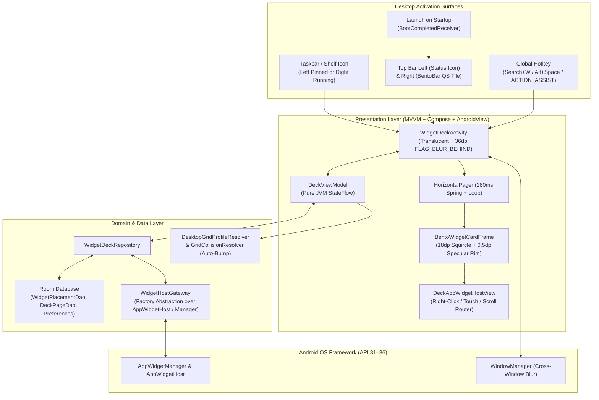

# Architecture & Development Plan: **WidgetLeaf** (`io.devnullapps.widgetleaf`)

> [!IMPORTANT]
> **Dual-Audience Specification:** This document is structured both as an **executive & architectural blueprint for human reviewers** and as an **executable, deterministic specification for autonomous development agents** operating in the Android Laptop Linux VM environment.
> **Design Bible Reference:** [WidgetLeaf — Design Bible & Asset Specification](https://docs.google.com/document/d/1noMsVDyMKCZhwh6bBdH45exHTnK5qCK6_NqssBTImI4/edit)

---

## 1. Brand Identity, Product Vision & Functional Requirements


### 1.1 Overview & Metaphor: *The Digital Flyleaf*
**WidgetLeaf** (`applicationId = "io.devnullapps.widgetleaf"`, output artifact `WidgetLeaf-debug.apk` / `WidgetLeaf-release.apk`) is an on-demand, frosted-glass HUD and modular widget deck designed specifically for Android Desktop and Laptop environments ("Googlebook").

In physical bookbinding, a *flyleaf* is the protective sheet resting directly inside the cover before the primary text begins. In **WidgetLeaf**, this becomes an ephemeral, translucent frosted-glass canopy that drops over active workspace windows via a **Taskbar/Shelf click**, **Top Menu Bar / BentoBar icon**, or **global hotkey** (`Search + W` / `Alt + Space` / `ACTION_ASSIST`), presenting live interactive Android widgets and vanishing instantly with a single keystroke (`Escape`) or outside click.

### 1.2 Functional Requirements Matrix

| Category | ID | Requirement | Acceptance Criteria |
| :--- | :--- | :--- | :--- |
| **Activation & Dismissal** | `FR-01` | **Taskbar Placement (Left Pinned vs. Right Running)** | Supports pinning to the main Taskbar dock (left/center) OR keeping a lightweight companion task active so the icon sits in the **"Running Apps"** section on the **right side** of the Taskbar divider when running. Clicking toggles the overlay; right-clicking / Ctrl-clicking / two-finger clicking opens the shortcut menu (**Overlay Settings** / **Add Widget**). |
| | `FR-02` | **Top Menu Bar / BentoBar Placement (Left vs. Right)** | Supports placing the top-bar trigger on the **Left of the Top Bar** (via an ongoing silent Status Bar icon/chip using the `24x24dp` 1-bit monochrome leaf-matrix vector glyph) and/or the **Right of the Top Bar** (via the Quick Settings / BentoBar `TileService` via `StatusBarManager.requestAddTileService`). |
| | `FR-03` | **Global Hotkey & Launch on Startup** | Registers for `Intent.ACTION_ASSIST` (Digital Assistant role / `Search + W` / `Alt + Space` hardware shortcut) and includes a **Launch on Startup** toggle (`RECEIVE_BOOT_COMPLETED` + `BootCompletedReceiver`) so configured top-bar / taskbar triggers are automatically restored on device boot. |
| | `FR-04` | **Instant & Smart Auto-Dismissal (Active Display)** | Launches on the **currently focused display** in multi-monitor setups. Pressing `Escape`, clicking on any empty blurred background area outside a widget, or re-triggering the hotkey/shelf icon immediately closes the overlay (`140ms` accelerate fade/scale out). Additionally, if a user clicks inside a widget to launch an external app `Activity` (e.g., opening a Calendar event or email), the overlay **automatically dismisses itself** while staying open for in-place widget `Broadcast`/`Service` actions (e.g., media play/pause or checking a to-do item). |
| **Visuals & Optical Physics** | `FR-05` | **Full-Screen Frosted Glass Blur (Zero Extra UI Chrome)** | Uses Android 12+ (`API 31+`) hardware-accelerated cross-window blur (`FLAG_BLUR_BEHIND` + `windowBackgroundBlurRadius = 36dp`) overlaid with `scrim-dark` (`rgba(10, 13, 16, 0.72)`), ambient `leaf-glow` radial backlighting (`rgba(16, 185, 129, 0.14)`), and a `2%` procedural noise grain shader to eliminate 8-bit gradient banding. Has **no header or toolbar chrome** and **no extra card wrapper around widgets**—just the blurred canvas, the native widgets, and the minimal **bottom** pagination pill. When Page 1 has zero widgets, displays a subtle centered hint (*"Right-click or press + to add a widget"*). Includes an automatic tinted scrim fallback if Battery Saver or Accessibility disables GPU blur. |
| **Multi-Page Canvas** | `FR-06` | **Multi-Page Virtual Desktop Deck, Bottom Pill & Auto-Pruning** | Supports $1 \dots N$ pages hosted inside a horizontal pager with a minimal virtual-desktop dot/pill/arrow HUD at the **bottom** of the screen. When $>1$ page exists, pages default to labels `1 .. N`. Right-clicking / two-finger clicking / long-pressing a page pill opens an inline editor: pressing `Enter` saves the label, and saving empty text resets it to its default number `1 .. N`. Empty pages (beyond the single remaining page) are **automatically deleted regardless of custom label** and remaining pages re-index cleanly. Includes a user setting to choose whether popping up the overlay opens the **last viewed page** or always resets to **Page 1**. |
| | `FR-07` | **Circular (Looping) Keyboard & Mouse Page Navigation** | Users can page left/right using `Left Arrow` / `Right Arrow`, `PageUp` / `PageDown`, number keys `1`–`9` and `0` (jumping directly to pages $1 \dots 10$), pagination pill arrow/dot clicks, or horizontal two-finger trackpad / mouse-wheel scrolling (`280ms` fluid spring `dampingRatio = 0.82f`, `stiffness = 380f`). Navigating past the last page **loops around to Page 1**, and navigating left from Page 1 **loops around to Page $N$**. |
| | `FR-08` | **Edge-Drag Page Transitions** | Dragging a widget to the left or right screen edge moves it onto the adjacent page. Dragging past the right edge of the last page dynamically creates a new page $(N+1)$, whereas dragging to the left of the first page (Page 1) is blocked. |
| | `FR-09` | **Desktop & Bento Grid, Snap & Auto-Bump Parity** | Supports `16dp` cell gutters and `48dp` external margins (matching both the host desktop's `WindowMetrics` / AOSP `Launcher3` `DeviceProfile` rules and the Design Bible's `1440dp` centered Bento grid proportions: `1×1` `140×140dp`, `2×1` `296×140dp`, `2×2` `296×296dp`, `4×2` `608×296dp`, `4×4` `608×608dp`). Moving or resizing a widget onto occupied cells **automatically bumps/shifts intersecting widgets** to nearby free cells on the page, snapping back only if no valid non-overlapping arrangement exists on that page. |
| **Widget Lifecycle & Manipulation** | `FR-10` | **Launcher3-Style Widget Picker, Placement & Settings Access** | Right-clicking / Ctrl-clicking / two-finger clicking (`BUTTON_SECONDARY`), long-pressing on empty blurred canvas, or pressing `Ctrl+N` / `+` opens the desktop context menu with **Widgets** (launching the `Launcher3`-style Widget Picker sheet) and **Overlay Settings**. Users can **drag a widget preview directly out of the picker** onto any grid cell or **click a widget and click "Add"** to auto-place it. **Overlay Settings** and **Add Widget** are also directly accessible by right-clicking / two-finger clicking the app's **Taskbar/Shelf icon** (`shortcuts.xml`) or long-pressing/right-clicking the **Quick Settings tile** (`ACTION_QS_TILE_PREFERENCES`). |
| | `FR-11` | **Live Widget Updates** | Calls `AppWidgetHost.startListening()` when the overlay opens (`onStart`) and `stopListening()` when dismissed (`onStop`) so widgets update live when viewed without draining battery in the background. |
| | `FR-12` | **Right-Click / Two-Finger Click Edit, Move, Resize & Remove** | Right-clicking / Ctrl-clicking / two-finger clicking (`BUTTON_SECONDARY`) or long-pressing a widget enters Edit/Move/Resize mode for that widget—displaying `leaf-primary` (`#10B981`) / `leaf-bright` (`#34D399`) 4-edge snap-to-cell resize handles (enforcing `resizeMode` and updating `OPTION_APPWIDGET_SIZES` in real time), drag-to-move (including cross-page edge dragging), a Reconfigure action (if supported), and Remove (`Delete`/`Backspace` or context action). |
| | `FR-13` | **Interactive Collection Widgets** | Scrollable widgets (`ListView`, `GridView`, `StackView` inside `RemoteViews`) smoothly receive vertical mouse-wheel (`MotionEvent.ACTION_SCROLL`) and touch gestures without fighting horizontal page swipes. |
| | `FR-14` | **Crash & Reboot Resilience** | Persists widget layout metadata (`appWidgetId`, provider `ComponentName`, `pageIndex`, `cellX`, `cellY`, `spanX`, `spanY`) and page labels in Room DB, reconciles orphaned widget IDs on startup, and isolates defective third-party widgets with a custom error view instead of crashing the overlay. |

---

## 2. Design Bible Specifications (Visual Tokens, Shaders, Icons & Motion)

### 2.1 Color Palette & Dynamic Material You Tokens (`Theme.kt` / `Color.kt`)

| Token Name | Hex / RGBA Value | Compose `Color` Literal | Usage in WidgetLeaf |
| :--- | :--- | :--- | :--- |
| `leaf-primary` | `#10B981` | `Color(0xFF10B981)` | Core brand emerald accent, focused widget resize frames, active page pill, primary toggles. |
| `leaf-bright` | `#34D399` | `Color(0xFF34D399)` | Specular resize handles, active telemetry indicators, hover outlines. |
| `leaf-glow` | `rgba(16, 185, 129, 0.14)` | `Color(0x2410B981)` | Ambient radial backlighting drawn behind active widget pages (Layer 2). |
| `glass-surface` | `rgba(255, 255, 255, 0.07)` / `rgba(22, 27, 34, 0.65)` | `Color(0xA6161B22)` | Frosted glass fill for interactive Bento widget containers. |
| `glass-surface-hover` | `rgba(255, 255, 255, 0.11)` | `Color(0x1CFFFFFF)` | Hover / edit highlight overlay on interactive cards and pills. |
| `glass-border` | `rgba(255, 255, 255, 0.15)` | `Color(0x26FFFFFF)` | `1dp` outer boundary stroke catching directional light on Bento widget cards & popovers. |
| `glass-specular` | `rgba(255, 255, 255, 0.35)` | `Color(0x59FFFFFF)` | `0.5dp` inner top/left beveled rim for glass refraction. |
| `scrim-dark` | `rgba(10, 13, 16, 0.72)` | `Color(0xB80A0D10)` | Full-screen backdrop tint applied beneath the `36dp` window blur. |
| `obsidian-base` | `#0A0D10` | `Color(0xFF0A0D10)` | Adaptive icon background plate & fallback dark surface. |
| `text-primary` | `#F9FAFB` | `Color(0xFFF9FAFB)` | Primary headers, page labels, context menu & settings titles. |
| `text-secondary` | `#9CA3AF` | `Color(0xFF9CA3AF)` | Supporting descriptions, keyboard shortcut badges, cell span tags (`2×2`). |
| `text-tertiary` | `#6B7280` | `Color(0xFF6B7280)` | Grid rulers, inactive pagination dots, empty-canvas hint text. |

* **Material You (Dynamic Color) Toggle:** When enabled in Overlay Settings on Android 12+, `leaf-primary` maps to `MaterialTheme.colorScheme.primary`, `glass-surface` maps to `surfaceContainerHighest.copy(alpha = 0.40f)`, and `scrim-dark` maps to `scrim.copy(alpha = 0.70f)`.

### 2.2 Optical Elevation Stack & Glass HUD Physics

1. **Layer 4 (`Z = 40dp`):** Floating HUD popovers (`DesktopContextMenu`, `WidgetPickerBottomSheet`, `OverlaySettingsDialog`, tooltips)—styled with `glass-surface` (`rgba(22, 27, 34, 0.65)`), `18dp` continuous squircle corners, `1dp` outer `glass-border`, and `0.5dp` top-left `glass-specular` bevel rim.
2. **Layer 3 (`Z = 16dp`):** Native Android Widgets (`DeckAppWidgetHostView`) rendered directly on the desktop grid without an artificial card wrapper (matching native Android desktop behavior), gaining a `leaf-primary` (`#10B981`) / `leaf-bright` (`#34D399`) 4-edge resize frame only when in Edit/Resize mode.
3. **Layer 2 (`Z = 4dp`):** **Bottom** Pagination HUD pill (`BottomPageIndicatorBar`) and ambient radial `leaf-glow` (`Brush.radialGradient` behind the active page's widget cluster).
4. **Layer 1 (`Z = 0dp`):** Optical Frost Scrim (`36dp` cross-window blur + `scrim-dark` `rgba(10, 13, 16, 0.72)` + `2%` subtle noise grain overlay to prevent 8-bit banding).
5. **Layer 0 (Host):** Active desktop application windows blurred beneath the `WidgetDeckActivity` window.

### 2.3 Icon & Asset Deployment Manifest

| Asset Context | Target Resource Location | Size / Format | Implementation Details |
| :--- | :--- | :--- | :--- |
| **Master / Play Store Icon** | `app/src/main/ic_launcher-playstore.png` | `512 × 512 px` 32-bit PNG | Generated directly from the uploaded WidgetLeaf master artwork (`widgetleaf_icon.jpg`). |
| **Adaptive Launcher Icon (`API 26+`)** | `res/mipmap-anydpi-v26/ic_launcher.xml` & `ic_launcher_round.xml` | `108 × 108 dp` (`72dp` safe zone) | **Background (`drawable/ic_launcher_background.xml`):** Deep obsidian slate (`#0A0D10`) with `35%` radial emerald core glow (`#10B981`).<br>**Foreground (`mipmap-*/ic_launcher_foreground.png` + vector):** Botanical leaf base + morphing midrib + frosted Bento cells & dispersing particles. |
| **Taskbar / BentoBar Pin Icon** | `res/drawable/ic_taskbar_pin.xml` | `48 × 48 dp` Vector / PNG | Crisp 3-cell frosted Bento leaf geometry with high-contrast specular borders. |
| **System Status Tray / QS Tile Icon** | `res/drawable/ic_qs_tile_leaf.xml` | `24 × 24 dp` Vector XML | 1-bit monochrome glyph: solid organic leaf base with cutaway geometric matrix cells (used by `WidgetDeckTileService` and `StatusBarTriggerManager`). |

### 2.4 Motion Curves & Choreography (`MotionSpec.kt`)

* **Overlay Entry (`220ms`):** `CubicBezierEasing(0.0f, 0.0f, 0.2f, 1.0f)` (Decelerate). Window blur blooms from `0dp` $\rightarrow$ `36dp`; widget cards scale from `0.96f` $\rightarrow$ `1.00f` and fade `0f` $\rightarrow$ `1f` with a `15ms` staggered cascade per column.
* **Overlay Exit (`140ms`):** `CubicBezierEasing(0.4f, 0.0f, 1.0f, 1.0f)` (Accelerate). Unified fade out (`1f` $\rightarrow$ `0f`) and scale down (`1.00f` $\rightarrow$ `0.98f`), calling `finish()` with zero OS window transition lag on completion.
* **Page Flip Transition (`280ms`):** `spring(dampingRatio = 0.82f, stiffness = 380f)`. Outgoing page translates `-20%` and fades to `0%`; incoming page translates `+20%` $\rightarrow$ `0%` with full opacity.

---

## 3. System Architecture & Android API Blueprint

### 3.1 High-Level Architecture Diagram



### 3.2 Detailed Android API Usage Specifications

#### A. `AppWidgetHost` & `AppWidgetManager` Lifecycle
* **Host ID & Listening Window:**
  * Instantiate `WidgetDeckHost(applicationContext, HOST_ID = 1042)`.
  * Call `appWidgetHost.startListening()` in `WidgetDeckActivity.onStart()` and `appWidgetHost.stopListening()` in `WidgetDeckActivity.onStop()`.
  * **Never** call `deleteHost()` on normal exit; only call `deleteAppWidgetId(id)` when a user deletes a widget or cancels configuration (`RESULT_CANCELED`).
* **Responsive Sizing (`API 31+`):**
  * Whenever a widget is placed or resized on the desktop grid, compute its pixel/dp bounds and pass `AppWidgetManager.OPTION_APPWIDGET_SIZES` (`ArrayList<SizeF>`) along with `OPTION_APPWIDGET_MIN_WIDTH/MAX_WIDTH/MIN_HEIGHT/MAX_HEIGHT` via `appWidgetManager.updateAppWidgetOptions(appWidgetId, optionsBundle)`.

#### B. Native Desktop & Bento Grid Parity (`DesktopGridProfileResolver` & `GridCollisionResolver`)
1. **Dynamic Host Display & Bento Grid Matching:**
   * Queries the active display's `WindowMetrics` (`WindowManager.getCurrentWindowMetrics()`), system bar insets (`WindowInsetsCompat.Type.systemBars()`), and `Configuration`.
   * Applies `16dp` cell gutters and `48dp` external margins within a centered canvas (up to `1440dp` max width, or full desktop width based on user preference), honoring standard Android & Bento unit proportions (`1×1` `140×140dp`, `2×1` `296×140dp`, `2×2` `296×296dp`, `4×2` `608×296dp`, `4×4` `608×608dp`) and AOSP `Launcher3` `DeviceProfile` cell counts.
2. **AOSP Widget Span Calculation (`WidgetSpanCalculator`):**
   * On `API 31+`, reads `providerInfo.targetCellWidth` and `providerInfo.targetCellHeight` first; if unset (`0`), converts `providerInfo.minWidth` and `providerInfo.minHeight` into `(spanX, spanY)` cells.
   * Enforces `providerInfo.resizeMode` (`RESIZE_HORIZONTAL`, `RESIZE_VERTICAL`, `RESIZE_BOTH`, or `RESIZE_NONE`), clamping minimum cell span via `minResizeWidth`/`minResizeHeight` and maximum cell span via `maxResizeWidth`/`maxResizeHeight`.
3. **Desktop-Style Auto-Bump / Reflow (`GridCollisionResolver`) & Empty Page Pruning:**
   * When a widget is dragged or resized over cells occupied by existing widgets, `GridCollisionResolver` computes a candidate layout by pushing intersecting widgets along the primary movement vector (or nearest Manhattan-distance vacant cells on the page). If no valid placement exists for all displaced widgets within the page's grid bounds, the drop is rejected and widgets snap back to their original cells.
   * Whenever a widget removal or cross-page transfer leaves any page (when total pages $> 1$) with `0` widgets, that page is automatically deleted regardless of custom label, and remaining pages re-index cleanly.

#### C. Custom `DeckAppWidgetHostView` (Right-Click / Two-Finger Click, Touch, Mouse Wheel & Error Isolation)
* **Touch & Secondary-Click Interception Modes:**
  * `INTERACTIVE` (Default): Passes primary left-clicks (`BUTTON_PRIMARY`) and vertical scroll gestures directly to the hosted `RemoteViews`, while intercepting right-clicks / two-finger trackpad clicks (`MotionEvent.BUTTON_SECONDARY`), `Ctrl + Click`, or long-presses (`ViewConfiguration.getLongPressTimeout()`) to immediately enter `EDIT_MODE` for that widget.
  * `EDIT_MODE`: Intercepts `onInterceptTouchEvent` so dragging anywhere on the widget moves it across grid cells or across the left/right screen edges onto adjacent pages (creating a new page when dragged off the right edge of the last page, and clamping at the left edge of Page 1). Exposes `leaf-primary` (`#10B981`) 4-edge snap-to-cell resize handles and a glassmorphic context action bar (Reconfigure / Remove).
* **Collection Widget & Mouse Wheel Delegation:**
  * Overrides `dispatchGenericMotionEvent(event: MotionEvent)`:
    * If `event.actionButton == MotionEvent.BUTTON_SECONDARY` or `(event.buttonState == MotionEvent.BUTTON_PRIMARY && event.isCtrlPressed)`, triggers `EDIT_MODE` on the widget.
    * When `event.action == MotionEvent.ACTION_SCROLL`, dispatches vertical scroll (`AXIS_VSCROLL`) to internal scrollable collections (`ListView`/`GridView`/`StackView`) first; if unconsumed or horizontal (`AXIS_HSCROLL`), delegates to the multi-page deck pager.
  * Overrides `requestDisallowInterceptTouchEvent(true)` to cancel pending long-press timers whenever a user scrolls an internal widget list.
* **Crash Isolation:**
  * Overrides `getErrorView()` to render a clean glassmorphic error card with a "Remove / Reload Widget" action if a third-party widget throws a `RemoteViews.ActionException` or inflation failure.
* **Smart Auto-Dismiss on Widget Activity Launch:**
  * Tracks internal permission/configuration launches (`isLaunchingInternalFlow: Boolean` for `ACTION_APPWIDGET_BIND` and `startAppWidgetConfigureActivityForResult`).
  * When `onUserLeaveHint()` / `onStop()` fires while `isLaunchingInternalFlow == false` (meaning the user clicked an item inside a widget whose `PendingIntent` launched an external `Activity` like Calendar or Gmail), `WidgetDeckActivity` immediately calls `dismissDeck()`. Conversely, in-widget `Broadcast` or `Service` `PendingIntent` actions (such as media Play/Pause or checking off a task) do not trigger `onUserLeaveHint()`, keeping the overlay open so the user sees the live update.
* **Launcher3-Parity Widget Picker (`WidgetsFullSheet` Emulation):**
  * Displays a searchable glassmorphic sheet grouping installed providers by application header with widget count badges.
  * Supports both **Drag-Out Placement** (closing the picker sheet immediately so the user can drop the widget onto any grid cell with live auto-bump preview) and **Click $\rightarrow$ "Add" Auto-Placement** (placing into the first available `(cellX, cellY)` region on the active page, or appending a new page $(N+1)$ if full).

#### D. Multi-Surface Activation, Top/Taskbar Left-vs-Right Placement, Startup & Keyboard Matrix
1. **Taskbar Placement (Left Pinned vs. Right Running Section) & Right-Click Menu (`shortcuts.xml` + `ShortcutManager`):**
   * **Left Side of Taskbar (Pinned):** Users can pin the launcher icon to the primary left/center app dock (`ShortcutManager.requestPinShortcut`).
   * **Right Side of Taskbar (Running Apps Divider):** When the user enables *"Show in Running Taskbar (Right)"* in Overlay Settings, a lightweight companion task remains registered so the icon sits on the right side of the taskbar divider while active.
   * Declares `<meta-data android:name="android.app.shortcuts" android:resource="@xml/shortcuts" />` so right-clicking / Ctrl-clicking / two-finger clicking the Taskbar icon pops up native desktop actions (**Overlay Settings** and **Add Widget**).
2. **Top Menu Bar / BentoBar Placement (Left vs. Right):**
   * **Top Bar Left (Status Bar Icon):** Enabling *"Pin to Top Bar (Left)"* posts an ongoing, silent `NotificationCompat` status bar icon (`StatusBarTriggerManager`) using `ic_qs_tile_leaf.xml` (`24x24dp` 1-bit monochrome leaf-matrix glyph) anchored in the top-left status bar area; clicking it immediately launches the overlay via `PendingIntent`, and its action button opens **Overlay Settings**.
   * **Top Bar Right (System Tray / Quick Settings Tile):** Enabling *"Pin to Top Bar (Right / BentoBar)"* invokes `StatusBarManager.requestAddTileService()` for `WidgetDeckTileService` (`API 34+` `startActivityAndCollapse(PendingIntent)`), and registers `ACTION_QS_TILE_PREFERENCES` so right-clicking/long-pressing the tile opens **Overlay Settings**.
3. **Launch on Startup (`BootCompletedReceiver`):**
   * Declares `android.permission.RECEIVE_BOOT_COMPLETED` and `BootCompletedReceiver` (`BOOT_COMPLETED` / `LOCKED_BOOT_COMPLETED`) to automatically restore the user's chosen Top Bar / Taskbar trigger surface upon login.
4. **Global Hotkey (`ACTION_ASSIST` & Keyboard Shortcuts) & Active Display Targeting:**
   * `WidgetDeckActivity` includes `<action android:name="android.intent.action.ASSIST" />` (`category.DEFAULT`) and `<meta-data android:name="android.app.shortcuts" />`, supporting `Search + W` / `Alt + Space` / Assistant key invocation.
   * Uses `ActivityOptions.setLaunchDisplayId()` when triggered from tiles/notifications so the overlay always opens on the **currently active display** in multi-monitor setups.
5. **In-Overlay Keyboard Navigation (`dispatchKeyEvent`):**
   * `Left Arrow` / `PageUp`: Previous page (wraps around from Page $1 \rightarrow$ Page $N$)
   * `Right Arrow` / `PageDown`: Next page (wraps around from Page $N \rightarrow$ Page $1$)
   * `1` – `9` and `0`: Jump directly to Pages $1 \dots 9$ and Page $10$ (`0` $\rightarrow$ index `9`)
   * `Ctrl + N` or `+`: Open Widget Picker sheet
   * `Delete` / `Forward Delete` / `Backspace`: Remove currently selected widget in Edit Mode
   * `Escape`: Exit inline page rename or widget Edit Mode if active; otherwise dismiss the overlay immediately (`140ms` exit animation)

---

## 4. Source Code Layout & Module Structure

```text
widgetleaf/
├── .github/
│   └── workflows/
│       ├── ci.yml                          # PR & Push: Lint + Unit/Robolectric Tests + Coverage + Debug APK
│       └── release.yml                     # Tag v*: Signed AAB + GitHub Release + Gradle Play Publisher
├── app/
│   ├── build.gradle.kts                    # namespace="io.devnullapps.widgetleaf", archivesBaseName="WidgetLeaf", SDK 35
│   ├── proguard-rules.pro
│   └── src/
│       ├── main/
│       │   ├── AndroidManifest.xml         # Exported declarations, zero PHA permissions
│       │   ├── ic_launcher-playstore.png   # 512x512 32-bit Master Icon Asset
│       │   ├── kotlin/io/devnullapps/widgetleaf/
│       │   │   ├── WidgetLeafApp.kt        # Application class & DI container initialization
│       │   │   ├── di/
│       │   │   │   └── AppContainer.kt     # Constructor DI factory wiring
│       │   │   ├── data/
│       │   │   │   ├── local/
│       │   │   │   │   ├── LeafDatabase.kt
│       │   │   │   │   ├── PreferencesDataStore.kt
│       │   │   │   │   ├── dao/
│       │   │   │   │   │   ├── WidgetPlacementDao.kt
│       │   │   │   │   │   └── DeckPageDao.kt
│       │   │   │   │   └── entity/
│       │   │   │   │       ├── WidgetPlacementEntity.kt
│       │   │   │   │       └── DeckPageEntity.kt
│       │   │   │   └── repository/
│       │   │   │       └── DefaultWidgetDeckRepository.kt
│       │   │   ├── domain/
│       │   │   │   ├── model/
│       │   │   │   │   ├── PlacedWidget.kt
│       │   │   │   │   ├── DeckPage.kt
│       │   │   │   │   ├── DesktopGridProfile.kt
│       │   │   │   │   ├── GridBounds.kt
│       │   │   │   │   ├── OverlaySettings.kt
│       │   │   │   │   └── WidgetCatalogItem.kt
│       │   │   │   ├── repository/
│       │   │   │   │   └── WidgetDeckRepository.kt
│       │   │   │   └── usecase/
│       │   │   │       ├── GridCollisionResolver.kt
│       │   │   │       ├── WidgetSpanCalculator.kt
│       │   │   │       ├── EdgePageDragTransferUseCase.kt
│       │   │   │       ├── ReconcileOrphanWidgetsUseCase.kt
│       │   │   │       └── CalculateResponsiveSizesUseCase.kt
│       │   │   ├── platform/
│       │   │   │   ├── WidgetHostGateway.kt            # Interface abstracting AppWidgetHost & Manager
│       │   │   │   ├── AndroidWidgetHostGateway.kt     # Real implementation using android.appwidget.*
│       │   │   │   ├── DesktopGridProfileResolver.kt   # Queries host WindowMetrics & Bento/Launcher3 grid profile
│       │   │   │   ├── BlurController.kt               # Interface for 36dp cross-window blur & fallback state
│       │   │   │   └── AndroidWindowBlurController.kt  # API 31+ FLAG_BLUR_BEHIND & listener
│       │   │   ├── services/
│       │   │   │   ├── WidgetDeckTileService.kt        # Top Bar Right: Quick Settings / BentoBar Tile (API 34+)
│       │   │   │   ├── StatusBarTriggerManager.kt      # Top Bar Left: Ongoing status-bar 1-bit leaf icon trigger
│       │   │   │   └── BootCompletedReceiver.kt        # Launch on Startup receiver (RECEIVE_BOOT_COMPLETED)
│       │   │   └── ui/
│       │   │       ├── WidgetDeckActivity.kt           # Translucent singleInstance host Activity
│       │   │       ├── viewmodel/
│       │   │       │   ├── DeckViewModel.kt            # Pure JVM StateFlow (pages, activeEditWidget, pickerState)
│       │   │       │   └── DeckUiState.kt
│       │   │       ├── hostview/
│       │   │       │   ├── WidgetDeckHost.kt           # Custom AppWidgetHost subclass
│       │   │       │   └── DeckAppWidgetHostView.kt    # Right-click/touch/drag/mouse-wheel/error-safe HostView
│       │   │       ├── components/
│       │   │       │   ├── BentoWidgetCardFrame.kt     # 18dp squircle glass card, 1dp border, 0.5dp specular rim
│       │   │       │   ├── PageIndicatorHud.kt         # Pagination pill + arrows + inline relabelable 1..N tags
│       │   │       │   ├── WidgetGridPage.kt           # Full-screen blurred 2D snapping grid & resize frame
│       │   │       │   ├── DesktopContextMenu.kt       # Right-click / two-finger click popup ("Add widget", etc.)
│       │   │       │   ├── OverlaySettingsDialog.kt    # Startup toggle, Top/Taskbar Left/Right pin, Page 1/Last, Blur
│       │   │       │   └── WidgetPickerBottomSheet.kt  # Launcher3-style searchable widget catalog
│       │   │       └── theme/
│       │   │           ├── Color.kt                    # Design Bible token swatches (leaf-primary, glass-*, scrim-dark)
│       │   │           ├── MotionSpec.kt               # 220ms entry, 140ms exit, 280ms spring page flip
│       │   │           └── Theme.kt                    # Material You dynamic color mapping & frosted shaders
│       │   └── res/
│       │       ├── drawable/
│       │       │   ├── ic_launcher_background.xml      # #0A0D10 obsidian with 35% radial #10B981 glow
│       │       │   ├── ic_launcher_foreground.xml      # Vector / high-res leaf + frosted Bento cells
│       │       │   ├── ic_taskbar_pin.xml              # 48x48dp simplified 3-cell Bento leaf
│       │       │   └── ic_qs_tile_leaf.xml             # 24x24dp 1-bit monochrome leaf with cutaway matrix cells
│       │       ├── mipmap-anydpi-v26/
│       │       │   ├── ic_launcher.xml
│       │       │   └── ic_launcher_round.xml
│       │       ├── xml/
│       │       │   └── shortcuts.xml                   # Taskbar right-click shortcuts (Settings, Add Widget)
│       │       └── values/
│       │           ├── strings.xml
│       │           └── styles.xml                      # Theme.WidgetLeaf.Translucent (36dp blur)
│       └── test/                                       # Pure JVM + Robolectric + Headless Compose tests
│           └── kotlin/io/devnullapps/widgetleaf/
│               ├── domain/
│               │   ├── GridCollisionResolverTest.kt
│               │   ├── WidgetSpanCalculatorTest.kt
│               │   ├── EdgePageDragTransferUseCaseTest.kt
│               │   ├── CalculateResponsiveSizesUseCaseTest.kt
│               │   └── ReconcileOrphanWidgetsUseCaseTest.kt
│               ├── data/
│               │   └── WidgetDeckRepositoryTest.kt     # Robolectric + In-memory Room DB tests
│               ├── ui/
│               │   ├── DeckViewModelTest.kt            # Pure JVM Coroutines StateFlow & Hotkey tests
│               │   ├── DeckScreenComposeTest.kt        # Headless Compose UI + Pager + Keyboard tests
│               │   └── DeckAppWidgetHostViewTest.kt    # Robolectric right-click/touch interception & error view tests
│               └── services/
│                   ├── WidgetDeckTileServiceTest.kt    # Robolectric QS tile state & click tests
│                   └── BootCompletedReceiverTest.kt    # Robolectric startup trigger restoration tests
└── build.gradle.kts
```

---

## 5. Environment, AOSP & Google Play Protect Compliance Rules

Development agents executing this plan on Android Laptop **MUST** follow these mandatory guardrails:

1. **Virtiofs / Local `ext4` Cache Redirection (Every Gradle Command):**
   ```bash
   ./gradlew <task> --project-cache-dir="$HOME/.cache/projects/$(basename "$PWD")-$(pwd -P | sha1sum | cut -c1-8)/gradle"
   ```
2. **Android CLI Toolchain:**
   Manage SDK packages strictly via `android sdk install platforms/android-35 build-tools/35.0.0 platform-tools` (never `sdkmanager`).
3. **AOSP & Play Protect Zero-Tolerance Guardrails:**
   * `namespace = "io.devnullapps.widgetleaf"`, `applicationId = "io.devnullapps.widgetleaf"`, `archivesBaseName = "WidgetLeaf"`.
   * `targetSdk = 35` (meets `>= 34` requirement), `minSdk = 31` (Android 12+ for native cross-window blur and modern responsive widgets).
   * `ndk.abiFilters += listOf("arm64-v8a", "x86_64")`.
   * **Zero Prohibited Permissions:** Do **NOT** declare `BIND_ACCESSIBILITY_SERVICE`, `SYSTEM_ALERT_WINDOW`, `REQUEST_INSTALL_PACKAGES`, `READ_SMS`, `RECEIVE_SMS`, or `BIND_NOTIFICATION_LISTENER_SERVICE`.
   * Explicit `android:exported="true"` or `"false"` on every `<activity>`, `<service>`, and `<receiver>`.
   * Never hide the launcher icon via `setComponentEnabledSetting`.

---

## 6. Testing Strategy (TDD & Headless JVM Verification)

All development follows the **Red $\rightarrow$ Green $\rightarrow$ Refactor** TDD loop inside the Linux VM without requiring a nested emulator:

| Test Layer | Runner & Frameworks | Key Scenarios Verified | Target Coverage |
| :--- | :--- | :--- | :--- |
| **1. Domain & Grid Math (Pure JVM)** | JUnit 4, Truth | Grid cell placement, auto-bump / reflow collision resolution, `SizeF` responsive dp calculations, right-edge new-page creation & left-of-Page-1 clamping, empty-page auto-pruning. | **>95%** |
| **2. ViewModel & Hotkey State (Pure JVM)** | JUnit 4, `kotlinx-coroutines-test` (`runTest`), Fake `WidgetHostGateway` | Circular arrow key looping, `1`–`9` & `0` page jumps, inline page label editing & empty-reset to `1..N`, `Escape` dismissal, widget bind/configure state machine (including `RESULT_CANCELED` cleanup of `appWidgetId`). | **>90%** |
| **3. Persistence & Reconciliation (Robolectric)** | `@RunWith(AndroidJUnit4::class)`, Room In-Memory DB | Saving multi-page widget placements and custom page labels, pruning orphaned widget IDs on startup, persisting Overlay Settings in DataStore. | **>90%** |
| **4. UI & Touch Interception (Headless Compose + Robolectric)** | `createComposeRule()`, Robolectric | Rendering `BentoWidgetCardFrame` & `PageIndicatorHud`, right-click / two-finger click context menu & widget `EDIT_MODE`, `DeckAppWidgetHostView` fallback `getErrorView()`, `BootCompletedReceiver`, and `BlurController` fallback scrim. | **>85%** |

* **Quality Gate:** Run `calculate_test_coverage` and `./gradlew lintDebug` before completion to verify **>80% overall line coverage** and **0 Lint errors**.

---

## 7. GitHub CI/CD & Release Pipeline

### 7.1 Continuous Integration (`.github/workflows/ci.yml`)
Triggered on every `push` and `pull_request` to `main`:
1. **Checkout & JDK 17 Setup** (`actions/setup-java@v4` with Gradle caching).
2. **Static Analysis & Lint:** `./gradlew lintDebug` (fails build on any Lint error or Play Protect manifest violation).
3. **Unit & Robolectric Suite:** `./gradlew testDebugUnitTest jacocoTestReport`.
4. **Coverage Enforcement:** Verifies line coverage $\ge 80\%$.
5. **Debug Artifact Upload:** Builds `WidgetLeaf-debug.apk` and uploads it as a GitHub Actions workflow artifact.

### 7.2 Automated Release & Play Store CD (`.github/workflows/release.yml`)
Triggered on pushing a version tag (`v*.*.*`):
1. **Keystore Decoding:** Decodes the 4096-bit RSA upload keystore (`ANDROID_UPLOAD_KEYSTORE_BASE64`) and Play Service Account JSON from GitHub Actions Secrets into ephemeral runner files.
2. **Signed Release Build:** Runs `./gradlew assembleRelease bundleRelease` with R8 minification (`isMinifyEnabled = true`, `isShrinkResources = true`) and APK Signature Schemes v2 & v3 enabled.
3. **GitHub Release Creation:** Attaches the signed `WidgetLeaf-release.apk` (for direct sideloading on Googlebooks) and `WidgetLeaf-release.aab` to a new GitHub Release.
4. **Google Play Publishing:** Runs `./gradlew publishBundle` via Gradle Play Publisher (`com.github.triplet.play`) to deploy to the `internal` / `production` track.

---

## 8. Phased Implementation Roadmap

* **Phase 1 — Project Scaffolding, Icons & Core Domain (TDD):**
  Initialize `widgetleaf` (`io.devnullapps.widgetleaf`) in `/storage/emulated/10/AntiGravity/Workspaces/widgetleaf` using Android CLI, generate adaptive launcher/taskbar/tray icons from the WidgetLeaf Master Icon, implement `GridCollisionResolver` (auto-bump), `WidgetSpanCalculator`, `EdgePageDragTransferUseCase`, Room DB, and Preferences DataStore with unit tests.
* **Phase 2 — `AppWidgetHost` Gateway & Custom `DeckAppWidgetHostView`:**
  Implement `WidgetDeckHost`, `DeckAppWidgetHostView` (right-click/Ctrl-click/two-finger click interception, mouse wheel scroll routing, smart auto-dismiss on external `Activity` launch, crash-safe `getErrorView()`), and `AndroidWidgetHostGateway`.
* **Phase 3 — Translucent Blurred Overlay Activity, Bento Glass Cards & Multi-Page UI:**
  Implement `WidgetDeckActivity` (`36dp` `FLAG_BLUR_BEHIND`, `scrim-dark` + `leaf-glow` + `2%` noise grain, `220ms` entry / `140ms` exit animations), `BentoWidgetCardFrame` (`18dp` squircle + `1dp` border + `0.5dp` specular rim), `PageIndicatorHud` (inline relabeling, circular looping), `DesktopContextMenu`, `WidgetPickerBottomSheet`, and `OverlaySettingsDialog`.
* **Phase 4 — Desktop Triggers, Top/Taskbar Placement & Hotkeys:**
  Wire Taskbar Left (Pinned) / Right (Running) placement, `shortcuts.xml` right-click menu, Top Bar Left (`StatusBarTriggerManager`) & Top Bar Right (`WidgetDeckTileService`), `BootCompletedReceiver` (Launch on Startup), `ACTION_ASSIST` global hotkey, and full keyboard navigation (`Left`/`Right`, `1`–`9` & `0`, `Ctrl+N`, `Delete`, `Escape`).
* **Phase 5 — Verification, Quality Audit & CI/CD:**
  Execute full Robolectric + Compose UI test suite, run `./gradlew lintDebug`, configure `.github/workflows/ci.yml` and `release.yml`, build signed `WidgetLeaf-debug.apk`, and present via `show_apk_file_in_explorer`.
